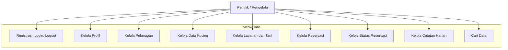
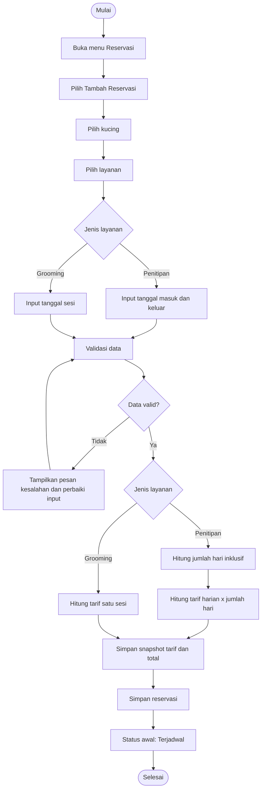
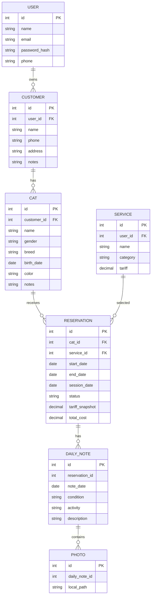
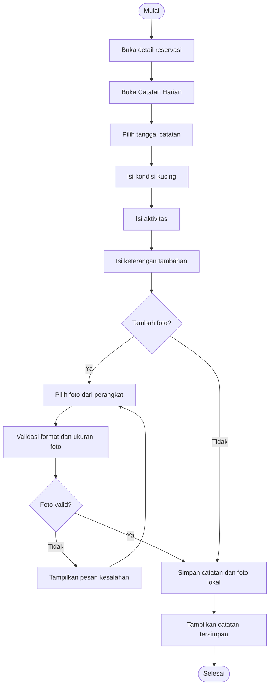

# Software Requirement Specification (SRS)
# MeowCare: Aplikasi Manajemen Penitipan & Grooming Kucing Berbasis Android

**Author:** Aurelia Citra Pangukir  
**NIM:** 20240140240  

## Document Information

| Field | Value |
|---|---|
| Document ID | SRS-MeowCare-v1.0 |
| Version Number | 1.0 (Requirements Baseline) |
| Issue Date | November 21, 2026 |
| Classification | Public |
| Reviewer | TBD |

## Copyright Notice

© 2026 Aurelia Citra Pangukir. All Rights Reserved.

This document is prepared for an academic mobile application development project. The content may be updated as requirements, design, and implementation evolve. This document is a public project artifact and does not carry contractual obligations.

## Revision History

| Date | Version | Description | Author |
|---|---|---|
| November 21, 2026 | 0.1 | Initial draft | Aurelia Citra Pangukir |
| November 21, 2026 | 0.2 | Clarification and completion of baseline business rules | Aurelia Citra Pangukir |
| November 21, 2026 | 0.3 | Added initial analysis models | Aurelia Citra Pangukir |
| November 21, 2026 | 0.4 | Defined baseline data fields and expanded ERD | Aurelia Citra Pangukir |
| November 21, 2026 | 0.5 | Defined backend hosting and token policy baseline | Aurelia Citra Pangukir |
| November 21, 2026 | 0.6 | Defined account deletion and data removal policy | Aurelia Citra Pangukir |
| November 21, 2026 | 0.7 | Defined user guide and API documentation plan | Aurelia Citra Pangukir |
| November 21, 2026 | 1.0 | Final audit and requirements baseline | Aurelia Citra Pangukir |
| November 21, 2026 | 0.4 | Defined baseline fields for User, Customer, Cat, and expanded ERD | Aurelia Citra Pangukir |

## Reviewed By

| Reviewer | Signature | Date |
|---|---|---|
| TBD | TBD | TBD |

## Sign Off

| Role | Name | Title/Organization | Date |
|---|---|---|---|
| Prepared By | Aurelia Citra Pangukir | Student / UMY | November 21, 2026 |
| Acknowledged By | TBD | TBD | TBD |
| Accepted By | TBD | TBD | TBD |

## Table of Contents
1. [Introduction](#1-introduction)
   - [1.1 Purpose](#11-purpose)
   - [1.2 Document Conventions](#12-document-conventions)
   - [1.3 Intended Audience and Reading Suggestions](#13-intended-audience-and-reading-suggestions)
   - [1.4 Project Scope](#14-project-scope)
   - [1.5 References](#15-references)
   - [1.6 Acronyms and Abbreviations](#16-acronyms-and-abbreviations)
2. [Overall Description](#2-overall-description)
   - [2.1 Product Perspective](#21-product-perspective)
   - [2.2 Product Features](#22-product-features)
   - [2.3 User Classes and Characteristics](#23-user-classes-and-characteristics)
   - [2.4 Operating Environment](#24-operating-environment)
   - [2.5 Design and Implementation Constraints](#25-design-and-implementation-constraints)
   - [2.6 User Documentation](#26-user-documentation)
   - [2.7 Assumptions and Dependencies](#27-assumptions-and-dependencies)
3. [System Features](#3-system-features)
4. [External Interface Requirements](#4-external-interface-requirements)
   - [4.1 User Interfaces](#41-user-interfaces)
   - [4.2 Hardware Interfaces](#42-hardware-interfaces)
   - [4.3 Software Interfaces](#43-software-interfaces)
   - [4.4 Communications Interfaces](#44-communications-interfaces)
5. [Other Nonfunctional Requirements](#5-other-nonfunctional-requirements)
   - [5.1 Performance Requirements](#51-performance-requirements)
   - [5.2 Safety Requirements](#52-safety-requirements)
   - [5.3 Security Requirements](#53-security-requirements)
   - [5.4 Software Quality Attributes](#54-software-quality-attributes)
6. [Other Requirements](#6-other-requirements)
- [Appendix A: Glossary](#appendix-a-glossary)
- [Appendix B: Analysis Models](#appendix-b-analysis-models)
- [Appendix C: Issues List](#appendix-c-issues-list)


## 1 Introduction

### 1.1 Purpose

Dokumen Software Requirement Specification (SRS) ini menjelaskan kebutuhan perangkat lunak MeowCare versi 1.0, yaitu aplikasi Android untuk membantu pemilik usaha penitipan dan grooming kucing mengelola data pelanggan, hewan, layanan, reservasi, dan catatan harian. Dokumen ini menjadi acuan awal bagi proses perancangan, implementasi, dan pengujian aplikasi. Ruang lingkup kebutuhan yang tercantum berfokus pada aplikasi Android dan layanan backend yang mendukung penyimpanan serta pengelolaan data.


### 1.2 Document Conventions

- Dokumen ditulis dalam Bahasa Indonesia.
- Istilah fitur dan teknologi dapat menggunakan nama resmi dalam Bahasa Inggris.
- Setiap kebutuhan fungsional memiliki ID unik dengan format `REQ-XXX` agar dapat dirujuk, ditinjau, dan diuji.
- Prioritas fitur ditandai **High**, **Medium**, atau **Low**.
- Informasi yang belum ditetapkan ditandai **TBD (To Be Determined)** dan tidak dianggap sebagai keputusan final.
- Kebutuhan pada draft ini merupakan baseline awal dan dapat berubah melalui revisi dokumen.


### 1.3 Intended Audience and Reading Suggestions

Dokumen ini ditujukan kepada:
- **Pengembang:** sebagai acuan kebutuhan dan batasan implementasi.
- **Penguji:** sebagai dasar menyusun skenario dan memeriksa pemenuhan kebutuhan.
- **Dosen/pembimbing/reviewer:** untuk meninjau tujuan, ruang lingkup, dan kesesuaian sistem dengan ketentuan proyek.
- **Pemilik usaha/pengguna aplikasi:** untuk memahami fungsi yang direncanakan dan alur pengelolaan usaha.

Pembaca disarankan memulai dari Bab 1 dan 2 untuk memahami konteks dan ruang lingkup, dilanjutkan Bab 3 untuk kebutuhan fungsional, kemudian Bab 4 dan 5 untuk interface serta kualitas sistem.


### 1.4 Project Scope

MeowCare merupakan aplikasi Android yang ditujukan untuk membantu pemilik usaha penitipan dan grooming kucing dalam mengelola operasional secara terorganisasi. Aplikasi berfokus pada pencatatan data pelanggan dan kucing, pengelolaan layanan beserta tarif, pencatatan reservasi, serta catatan harian selama masa penitipan.

Tujuan utama MeowCare:
- Memusatkan data pelanggan dan hewan dalam satu aplikasi.
- Memudahkan pencatatan dan pengelolaan layanan serta tarif.
- Membantu pencatatan reservasi dan status penitipan.
- Mendukung pencatatan kondisi atau aktivitas harian kucing selama penitipan.
- Mengurangi ketergantungan pada pencatatan manual yang terpisah.

MeowCare pada versi awal ditujukan untuk satu pemilik/pengelola akun. Aplikasi tidak mencakup akun pelanggan, multi-role admin, pembayaran online, notifikasi eksternal, atau pemesanan mandiri oleh pelanggan. Pemilik dapat menghapus akun melalui aplikasi dengan konfirmasi; penghapusan akun menghapus data cloud dan catatan harian/foto lokal terkait secara permanen. Aplikasi mendukung layanan penitipan dengan tarif per hari dan grooming dengan tarif per sesi. Reservasi penitipan menggunakan rentang tanggal, sedangkan reservasi grooming menggunakan tanggal sesi.


### 1.5 References

| Reference | Description | Version/Date | Location |
|---|---|---|---|
| Software Requirement Specification Document Template | Struktur dan panduan penyusunan SRS yang digunakan pada dokumen ini | Uploaded template / TBD | Template SRS proyek |\n| Render Documentation — Your First Deploy | Panduan deployment web service untuk aplikasi backend | Accessed November 21, 2026 | https://render.com/docs/your-first-deploy |\n| Render Documentation — Deploy for Free | Informasi keterbatasan layanan gratis | Accessed November 21, 2026 | https://render.com/docs/free |
| Pedoman PAM 2026 | Ketentuan proyek akhir Pengembangan Aplikasi Mobile | 2026 | Materi/pedoman perkuliahan; lokasi TBD |
| MeowCare README | Ringkasan tujuan, scope, fitur, dan teknologi proyek | Initial version, 2026-11-21 | https://github.com/aureliacitra/MeowCare_0240/blob/master/README.md |


### 1.6 Acronyms and Abbreviations

| Term | Definition |
|---|---|
| SRS | Software Requirements Specification |
| Android | Operating system for mobile devices |
| API | Application Programming Interface |
| REST | Representational State Transfer architectural style for web services |
| CRUD | Create, Read, Update, Delete |
| MVVM | Model–View–ViewModel architectural pattern |
| UI | User Interface |
| JWT | JSON Web Token |
| TBD | To Be Determined |


## 2 Overall Description

### 2.1 Product Perspective

MeowCare merupakan produk perangkat lunak baru berupa aplikasi Android yang terhubung dengan backend REST API dan database PostgreSQL yang di-host secara cloud. Aplikasi Android menjadi antarmuka utama pemilik untuk mengelola data operasional. Backend menangani autentikasi, validasi, aturan bisnis, otorisasi kepemilikan data, serta komunikasi dengan database.

Gambaran komponen utama:

```text
Pemilik
  |
Aplikasi Android (Kotlin, Jetpack Compose)
  |
REST API (Node.js, Express)
  |
Database PostgreSQL (Cloud / Supabase)
```

Data operasional utama disimpan di backend/database cloud. Catatan harian reservasi dan foto terkait pada versi awal disimpan di penyimpanan lokal perangkat dan tidak disinkronkan ke cloud.

### 2.2 Product Features

| Feature | Summary |
|---|---|
| Authentication and Profile | Registrasi/login, pengelolaan profil, logout, dan penghapusan akun |
| Pelanggan | Mengelola data pelanggan, melihat, mencari, mengubah, dan menghapus data sesuai aturan relasi |
| Hewan | Mengelola data kucing milik pelanggan dan melihat data terkait |
| Layanan | Mengelola jenis layanan dan tarif yang ditawarkan |
| Reservasi | Membuat dan mengelola reservasi untuk satu kucing dan satu layanan per reservasi, termasuk status dan perhitungan biaya |
| Catatan Harian | Mencatat kondisi, aktivitas, keterangan, dan foto kucing per hari selama reservasi, disimpan lokal |

Detail kebutuhan tiap fitur dijelaskan pada Bab 3.

### 2.3 User Classes and Characteristics

| User Class | Characteristics | Access |
|---|---|---|
| Pemilik/Pengelola | Pengguna utama; mengelola data operasional dan memiliki kemampuan dasar menggunakan Android | Seluruh fitur aplikasi setelah autentikasi |

Tidak terdapat role admin terpisah maupun akun pelanggan pada versi awal.

### 2.4 Operating Environment

- Perangkat: smartphone Android dengan versi minimum Android 8.0 (API 26).
- Aplikasi: Android native menggunakan Kotlin dan Jetpack Compose dengan Material 3.
- Navigasi: Jetpack Navigation Compose.
- Pola arsitektur: MVVM; UI mengamati state ViewModel melalui StateFlow.
- Backend: Node.js dan Express REST API.
- Database: PostgreSQL cloud menggunakan Supabase.
- Koneksi: internet dibutuhkan untuk autentikasi dan operasi data cloud.
- Catatan harian dan foto: penyimpanan lokal perangkat Android.

### 2.5 Design and Implementation Constraints

- Aplikasi Android harus menggunakan Kotlin dan Jetpack Compose serta Material 3; UI tidak menggunakan XML layout.
- Navigasi halaman menggunakan Jetpack Navigation Compose.
- Arsitektur aplikasi menerapkan MVVM dengan pemisahan UI, ViewModel, model, repository, dan sumber data.
- State UI dikelola di ViewModel menggunakan StateFlow atau MutableStateFlow dan diamati oleh Composable.
- Backend menyediakan REST API menggunakan Node.js/Express.
- Database menggunakan PostgreSQL cloud dengan Supabase sebagai penyedia database.
- Android tidak menggunakan Room atau SQLite sebagai database aplikasi.
- Aplikasi harus memiliki fungsi membaca dan menyimpan file lokal, khususnya catatan harian dan foto terkait reservasi.
- Data cloud memerlukan koneksi internet; perilaku saat offline untuk data cloud TBD.
- Data yang dimiliki akun harus diotorisasi berdasarkan identitas akun terautentikasi, bukan user_id yang dipercaya dari input klien.

### 2.6 User Documentation

Dokumentasi yang direncanakan:
- README proyek berisi deskripsi, ruang lingkup, teknologi, dan status pengembangan.
- SRS sebagai spesifikasi kebutuhan sistem.
- Panduan penggunaan aplikasi direncanakan dibuat setelah UI utama selesai.
- Dokumentasi API/backend direncanakan disusun saat backend dikembangkan, mencakup endpoint, request, response, dan error.

### 2.7 Assumptions and Dependencies

- Aplikasi digunakan oleh satu pemilik/pengelola usaha.
- Pemilik memiliki perangkat Android dan koneksi internet untuk menggunakan fitur cloud.
- Data pelanggan, hewan, layanan, dan reservasi tersimpan di backend/database cloud.
- Catatan harian dan foto disimpan lokal; pengguna bertanggung jawab menjaga perangkat dan file lokal.
- Backend, database, dan layanan hosting bergantung pada ketersediaan penyedia pihak ketiga.
- Backend Express di-deploy sebagai web service pada Render. Database PostgreSQL menggunakan Supabase.
- Aturan bisnis yang belum ditetapkan akan diputuskan pada tahap analisis lanjutan dan dicatat dalam Issues List.


## 3 System Features

> Kebutuhan fungsional berikut merupakan baseline versi 0.2 dan memiliki ID untuk traceability serta penyusunan test case.


### 3.1 Authentication and Profile

#### 3.1.1 Description and Priority

Fitur autentikasi memungkinkan pemilik mendaftarkan akun dan masuk ke aplikasi. Profil digunakan untuk mengidentifikasi pemilik akun. Fitur juga menyediakan penghapusan akun yang menghapus data akun secara permanen setelah konfirmasi. **Priority: High.**

#### 3.1.2 Stimulus/Response Sequences

1. Pemilik membuka aplikasi dan memilih registrasi atau login.
2. Pemilik memasukkan data autentikasi.
3. Sistem memvalidasi data dan mengirim permintaan ke backend.
4. Backend memeriksa data akun; sistem menampilkan hasil dan membuka halaman utama jika berhasil, atau pesan kesalahan jika gagal.\n5. Pemilik dapat membuka pengaturan akun dan meminta penghapusan akun.\n6. Sistem meminta konfirmasi, menghapus data cloud dan catatan harian/foto lokal terkait, lalu mengarahkan pengguna ke halaman login/registrasi.

#### 3.1.4 Functional Requirements

- **REQ-001:** Sistem harus menyediakan proses registrasi akun pemilik.
- **REQ-002:** Sistem harus menyediakan proses login untuk akun pemilik yang terdaftar.
- **REQ-003:** Sistem harus memvalidasi input autentikasi dan menampilkan pesan ketika input tidak valid atau autentikasi gagal.
- **REQ-004:** Sistem harus menyediakan proses logout.
- **REQ-005:** Backend harus membatasi akses data operasional pada akun yang terautentikasi dan berhak atas data tersebut.
- **REQ-006:** Sistem harus menyediakan pengelolaan profil dasar pemilik.
- **REQ-051:** Sistem harus menyediakan penghapusan akun pemilik setelah konfirmasi dan menghapus seluruh data cloud milik akun serta catatan harian dan foto lokal terkait.

### 3.2 Pelanggan

#### 3.2.1 Description and Priority

Fitur Pelanggan digunakan untuk menyimpan dan mengelola identitas serta informasi kontak pelanggan yang menitipkan atau menggunakan layanan. **Priority: High.**

#### 3.2.2 Stimulus/Response Sequences

1. Pemilik membuka menu Pelanggan.
2. Sistem menampilkan daftar pelanggan dan menyediakan pencarian.
3. Pemilik dapat membuka detail, menambah, mengubah, atau menghapus pelanggan.
4. Sistem memvalidasi data, menyimpan perubahan, dan menampilkan hasil.
5. Sistem menolak penghapusan pelanggan jika masih memiliki data hewan terkait.

#### 3.2.3 Functional Requirements

- **REQ-007:** Sistem harus menampilkan daftar pelanggan milik akun yang sedang login.
- **REQ-008:** Sistem harus menyediakan pencarian pelanggan berdasarkan nama.
- **REQ-009:** Sistem harus menyediakan penambahan data pelanggan.
- **REQ-010:** Sistem harus menyediakan detail data pelanggan.
- **REQ-011:** Sistem harus menyediakan pengubahan data pelanggan.
- **REQ-012:** Sistem harus menyediakan penghapusan data pelanggan apabila tidak memiliki data hewan yang masih terkait.
- **REQ-013:** Sistem harus menolak penghapusan pelanggan yang masih memiliki data hewan terkait dan menampilkan alasan penolakan.
- **REQ-014:** Sistem harus memvalidasi data pelanggan sebelum menyimpan.

### 3.3 Hewan

#### 3.3.1 Description and Priority

Fitur Hewan digunakan untuk mengelola data kucing yang terkait dengan pelanggan. **Priority: High.**

#### 3.3.2 Stimulus/Response Sequences

1. Pemilik membuka detail pelanggan atau menu Hewan.
2. Sistem menampilkan data kucing terkait.
3. Pemilik menambah, membuka detail, mengubah, mencari, atau menghapus data kucing.
4. Sistem memvalidasi dan menyimpan perubahan.
5. Sistem menolak penghapusan kucing yang masih memiliki reservasi terkait.

#### 3.3.3 Functional Requirements

- **REQ-015:** Sistem harus menyimpan data hewan dan mengaitkannya dengan pelanggan.
- **REQ-016:** Sistem harus menampilkan daftar hewan serta detail hewan.
- **REQ-017:** Sistem harus menyediakan pencarian hewan berdasarkan nama.
- **REQ-018:** Sistem harus menyediakan penambahan data hewan.
- **REQ-019:** Sistem harus menyediakan pengubahan data hewan.
- **REQ-020:** Sistem harus menyediakan penghapusan data hewan jika tidak memiliki reservasi terkait.
- **REQ-021:** Sistem harus menolak penghapusan hewan yang masih memiliki reservasi terkait dan menampilkan alasan penolakan.
- **REQ-022:** Sistem harus memvalidasi data hewan sebelum menyimpan.

### 3.4 Layanan

#### 3.4.1 Description and Priority

Fitur Layanan digunakan untuk mengelola daftar layanan penitipan/grooming yang ditawarkan beserta tarif. **Priority: High.**

#### 3.4.2 Stimulus/Response Sequences

1. Pemilik membuka menu Layanan.
2. Sistem menampilkan daftar layanan dan pencarian.
3. Pemilik menambah, membuka detail, mengubah, atau menghapus layanan.
4. Sistem memvalidasi data dan menyimpan perubahan.
5. Sistem menolak penghapusan layanan yang masih digunakan reservasi.

#### 3.4.3 Functional Requirements

- **REQ-023:** Sistem harus menampilkan daftar layanan milik akun.
- **REQ-024:** Sistem harus menyediakan pencarian layanan berdasarkan nama.
- **REQ-025:** Sistem harus menyediakan penambahan layanan dengan nama, kategori layanan (Penitipan atau Grooming), dan tarif sesuai kategori perhitungan.
- **REQ-026:** Sistem harus menyediakan detail layanan.
- **REQ-027:** Sistem harus menyediakan pengubahan layanan dan tarif.
- **REQ-028:** Sistem harus menyediakan penghapusan layanan apabila tidak digunakan reservasi.
- **REQ-029:** Sistem harus menolak penghapusan layanan yang masih direferensikan reservasi dan menampilkan alasan penolakan.
- **REQ-030:** Sistem harus memvalidasi nama layanan, kategori layanan, dan tarif sebelum penyimpanan; tarif harus bernilai lebih dari nol.

### 3.5 Reservasi

#### 3.5.1 Description and Priority

Fitur Reservasi digunakan untuk mencatat penggunaan satu layanan oleh satu kucing dalam satu reservasi, termasuk periode, status, dan total biaya. **Priority: High.**

#### 3.5.2 Stimulus/Response Sequences

1. Pemilik membuka menu Reservasi.
2. Sistem menampilkan daftar reservasi dan pencarian berdasarkan nama kucing.
3. Pemilik membuat reservasi dengan memilih kucing, layanan, periode, dan informasi yang diperlukan.
4. Sistem memvalidasi input dan menghitung biaya berdasarkan aturan tarif.
5. Pemilik dapat melihat detail, mengubah, atau menghapus reservasi.
6. Pemilik memperbarui status reservasi sesuai proses layanan, termasuk ketika layanan dimulai, selesai, atau dibatalkan.

#### 3.5.3 Functional Requirements

- **REQ-031:** Sistem harus menampilkan daftar reservasi milik akun.
- **REQ-032:** Sistem harus menyediakan pencarian reservasi berdasarkan nama kucing.
- **REQ-033:** Sistem harus menyediakan pembuatan reservasi yang menghubungkan satu kucing dengan satu layanan.
- **REQ-034:** Sistem harus menyimpan tanggal reservasi; reservasi penitipan memiliki tanggal mulai dan tanggal selesai, sedangkan reservasi grooming memiliki tanggal sesi.
- **REQ-035:** Sistem harus menyediakan detail reservasi.
- **REQ-036:** Sistem harus menyediakan pengubahan reservasi.
- **REQ-037:** Sistem harus menyediakan penghapusan reservasi.
- **REQ-038:** Sistem harus menyediakan status reservasi Terjadwal, Berlangsung, Selesai, dan Dibatalkan. Status Berlangsung digunakan untuk penitipan maupun grooming.
- **REQ-039:** Sistem harus menghitung biaya penitipan berdasarkan jumlah tanggal kalender secara inklusif (tanggal mulai dan tanggal selesai dihitung), dikalikan tarif harian, dengan minimum satu hari tagihan. Reservasi satu tanggal dikenakan satu hari tarif.
- **REQ-040:** Sistem harus menghitung biaya grooming per sesi berdasarkan tarif layanan. Reservasi grooming dihitung satu sesi untuk satu kucing.
- **REQ-041:** Sistem harus menyimpan snapshot jenis perhitungan tarif, tarif yang digunakan, dan total biaya pada saat reservasi dibuat atau diperbarui sehingga perubahan tarif layanan tidak mengubah reservasi lama secara otomatis.
- **REQ-042:** Sistem harus memvalidasi data reservasi, termasuk keterkaitan kucing dan layanan, kesesuaian jenis layanan dengan perhitungan tarif, kelengkapan tanggal, dan memastikan tanggal selesai penitipan tidak lebih awal dari tanggal mulai, sebelum menyimpan.

### 3.6 Catatan Harian

#### 3.6.1 Description and Priority

Fitur Catatan Harian digunakan untuk mencatat kondisi, aktivitas, dan informasi kucing selama menjalani reservasi penitipan. Catatan harian tidak diwajibkan untuk reservasi grooming. Catatan dan foto disimpan di perangkat. **Priority: Medium.**

#### 3.6.2 Stimulus/Response Sequences

1. Pemilik membuka detail reservasi.
2. Pemilik memilih catatan harian.
3. Sistem menampilkan catatan untuk reservasi tersebut.
4. Pemilik menambahkan atau mengubah catatan tanggal tertentu, mengisi kondisi/aktivitas/keterangan, dan menambahkan foto bila diperlukan.
5. Sistem menyimpan catatan dan file foto di perangkat.

#### 3.6.3 Functional Requirements

- **REQ-043:** Sistem harus menyediakan catatan harian yang terkait dengan reservasi penitipan.
- **REQ-044:** Sistem harus menyediakan pencatatan tanggal, kondisi, aktivitas, dan keterangan harian. Setiap reservasi hanya memiliki satu catatan harian untuk satu tanggal.
- **REQ-045:** Sistem harus menyediakan penambahan foto opsional pada catatan harian, dengan maksimal tiga foto per catatan.
- **REQ-046:** Sistem harus menyimpan catatan harian dan foto terkait pada penyimpanan lokal perangkat. Foto yang didukung adalah JPEG/JPG dan PNG dengan ukuran maksimal 5 MB per foto.
- **REQ-047:** Sistem harus menyediakan pembacaan daftar dan detail catatan harian berdasarkan reservasi.
- **REQ-048:** Sistem harus menyediakan pengubahan dan penghapusan catatan harian.
- **REQ-049:** Sistem harus menyediakan pencarian catatan harian berdasarkan kata kunci atau tanggal.
- **REQ-050:** Sistem harus menangani kondisi ketika file foto tidak tersedia atau gagal dibaca dengan menampilkan informasi yang sesuai tanpa menyebabkan aplikasi berhenti.


## 4 External Interface Requirements

### 4.1 User Interfaces

- Aplikasi menggunakan UI Android native yang dibangun dengan Jetpack Compose dan Material 3.
- Bahasa UI utama adalah Bahasa Indonesia.
- UI menyediakan navigasi ke modul Pelanggan, Hewan, Layanan, Reservasi, dan Catatan Harian sesuai konteks.
- Form input menyediakan label, validasi, dan pesan kesalahan yang mudah dipahami.
- UI harus menampilkan indikator proses, kondisi kosong, keberhasilan, dan kegagalan ketika diperlukan.
- Desain visual rinci, warna, ikon, dan layout akan ditentukan pada tahap UI/UX.

### 4.2 Hardware Interfaces

- Perangkat Android untuk menjalankan aplikasi.
- Foto catatan harian dapat dipilih dari galeri atau melalui file picker Android.
- Penyimpanan lokal perangkat digunakan untuk menyimpan catatan harian dan foto.
- Aplikasi tidak mensyaratkan hardware khusus selain perangkat Android yang mendukung versi minimum OS.

### 4.3 Software Interfaces

| Component | Role / Interface |
|---|---|
| Android OS | Menjalankan aplikasi dan menyediakan akses file/foto |
| REST API (Node.js/Express) | Autentikasi, validasi, aturan bisnis, dan operasi data melalui HTTP API |
| PostgreSQL (Cloud) | Penyimpanan data akun dan data operasional terstruktur |
| Supabase | Penyedia PostgreSQL cloud |
| JWT | Mekanisme token autentikasi untuk permintaan API |
| Kotlin / Jetpack Compose / Material 3 | Teknologi aplikasi Android dan UI |
| Jetpack Navigation Compose | Navigasi layar aplikasi |

Detail endpoint, skema payload, versi library, dan kontrak API akan ditentukan pada dokumen desain/API berikutnya.

### 4.4 Communications Interfaces

- Aplikasi Android berkomunikasi dengan backend melalui REST API menggunakan HTTP/HTTPS.
- Payload API menggunakan JSON.
- HTTPS digunakan pada deployment publik untuk melindungi data selama transmisi.
- Endpoint API memerlukan autentikasi untuk operasi data privat.
- Autentikasi menggunakan access token berumur 15 menit dan refresh token berumur 7 hari. Refresh token dirotasi ketika digunakan untuk refresh dan dapat dicabut saat logout.
- Aplikasi membutuhkan koneksi internet untuk operasi cloud. Dukungan offline untuk data cloud tidak termasuk baseline awal.


## 5 Other Nonfunctional Requirements

### 5.1 Performance Requirements

- Sistem harus memberikan feedback visual ketika permintaan data atau penyimpanan sedang berlangsung.
- Sistem harus menangani kegagalan koneksi atau respons server dengan pesan yang dapat dipahami dan tidak menutup aplikasi secara tiba-tiba.
- Untuk kondisi jaringan normal, operasi data utama ditargetkan memberikan respons dalam 3 detik, tidak termasuk waktu pemilihan atau pemuatan foto lokal. Target ini dievaluasi pada pengujian dan dapat disesuaikan berdasarkan hasil.

### 5.2 Safety Requirements

- Catatan harian ditujukan sebagai dokumentasi kondisi dan aktivitas, bukan sebagai alat diagnosis medis.
- Pengguna harus dapat melihat kembali catatan yang tersimpan untuk membantu pemantauan selama masa penitipan.
- Aplikasi tidak boleh mengklaim diagnosis atau rekomendasi pengobatan otomatis.

### 5.3 Security Requirements

- **SEC-001:** Sistem harus mengharuskan autentikasi sebelum mengakses data operasional privat.
- **SEC-002:** Backend harus memverifikasi token autentikasi pada endpoint privat.
- **SEC-003:** Backend harus menentukan kepemilikan data berdasarkan identitas akun dari token yang tervalidasi, bukan mempercayai identitas pemilik yang dikirim klien.
- **SEC-004:** Sistem harus mencegah akun mengakses atau mengubah data milik akun lain.
- **SEC-005:** Sistem harus memvalidasi input yang diterima dari klien sebelum diproses atau disimpan.
- **SEC-006:** Data dikirim melalui HTTPS pada lingkungan deployment publik.
- **SEC-007:** Token dan informasi autentikasi tidak boleh ditampilkan pada UI atau dicatat ke log yang tidak aman.
- **SEC-008:** Aplikasi harus menyimpan token autentikasi menggunakan mekanisme penyimpanan Android yang aman; refresh token harus dapat dirotasi dan dicabut saat logout.
- **SEC-009:** Sistem harus meminta konfirmasi sebelum menghapus akun dan memastikan data cloud milik akun serta catatan harian/foto lokal terkait dihapus secara permanen.

### 5.4 Software Quality Attributes

- **Usability:** Alur CRUD utama harus dapat dilakukan melalui navigasi dan form yang konsisten serta pesan yang jelas.
- **Maintainability:** Implementasi Android harus memisahkan UI, ViewModel, model, repository, dan sumber data sesuai arsitektur yang ditetapkan.
- **Reliability:** Kegagalan API, input invalid, atau file lokal yang hilang harus ditangani tanpa menyebabkan aplikasi crash yang tidak terkontrol.
- **Testability:** Kebutuhan fungsional memiliki ID unik untuk membantu penurunan test case.
- **Portability:** Aplikasi dirancang untuk smartphone Android 8.0 (API 26) atau lebih baru.
- **Data integrity:** Relasi data pelanggan, hewan, layanan, dan reservasi harus dijaga; penghapusan data yang masih direferensikan dibatasi sesuai requirement.


## 6 Other Requirements

- Data pelanggan, hewan, layanan, dan reservasi disimpan pada database cloud.
- Data catatan harian dan foto pada versi awal disimpan secara lokal di perangkat Android.
- Data tarif yang digunakan dalam reservasi disimpan sebagai snapshot untuk menjaga nilai reservasi lama.
- Penghapusan akun merupakan proses khusus yang menghapus seluruh data cloud akun dan data catatan harian/foto lokal terkait secara permanen setelah konfirmasi pengguna.
- Aturan penghapusan data berelasi harus mencegah penghapusan yang menyebabkan referensi reservasi tidak valid.
- Backup/restore otomatis catatan harian dan foto tidak termasuk versi awal.
- Ekspor data operasional belum termasuk baseline awal.
- Pengguna bertanggung jawab menjaga data lokal dan menghindari penghapusan file aplikasi yang dapat menghilangkan catatan lokal.


## Appendix A: Glossary

| Term | Definition |
|---|---|
| Pelanggan | Orang yang menggunakan layanan penitipan atau grooming |
| Hewan | Kucing milik pelanggan yang dicatat dalam sistem |
| Layanan | Jenis layanan yang disediakan beserta tarifnya |
| Reservasi | Catatan penggunaan satu layanan oleh satu kucing pada periode atau sesi tertentu |
| Catatan Harian | Catatan kondisi, aktivitas, dan keterangan kucing selama reservasi |
| Snapshot Tarif | Salinan tarif yang digunakan pada reservasi saat dibuat atau diperbarui |
| Pemilik | Pengguna utama yang mengelola usaha dan data di aplikasi |
| CRUD | Create, Read, Update, Delete |


## Appendix B: Analysis Models

Model analisis berikut memberikan gambaran visual interaksi pengguna, alur reservasi, dan hubungan data berdasarkan requirement pada Bab 3. Diagram bersifat konseptual; detail atribut, implementasi penyimpanan, dan desain teknis dapat disempurnakan pada tahap perancangan tanpa mengubah baseline kebutuhan secara diam-diam.

### B.1 Use Case Diagram

MeowCare memiliki satu aktor utama, yaitu Pemilik/Pengelola. Aktor berinteraksi dengan fitur autentikasi dan profil, Pelanggan, Hewan, Layanan, Reservasi, dan Catatan Harian. Pencarian merupakan fungsi di dalam modul yang relevan, bukan modul operasional terpisah.



### B.2 Activity Diagram — Pembuatan Reservasi

Alur pembuatan reservasi dimulai dari pemilihan kucing dan layanan. Input tanggal bergantung pada jenis layanan, dan total biaya dihitung sebelum reservasi disimpan.



Aturan perhitungan:
- Penitipan: tanggal mulai dan tanggal selesai dihitung sebagai hari yang ditagihkan; satu tanggal dihitung satu hari.
- Grooming: satu reservasi mewakili satu sesi untuk satu kucing.
- Snapshot tarif dan total biaya disimpan agar perubahan tarif layanan tidak otomatis mengubah reservasi sebelumnya.

### B.3 Entity Relationship Diagram (ERD)

ERD berikut memuat entitas cloud dan lokal beserta atribut baseline yang telah ditentukan pada tahap analisis. Atribut opsional tetap boleh kosong.



#### Baseline Atribut Data

**User / Pemilik**
| Field | Required | Description |
|---|---|---|
| id | Otomatis | ID akun |
| name | Ya | Nama pemilik/pengelola |
| email | Ya | Email untuk login |
| password_hash | Ya | Password yang disimpan dalam bentuk hash, bukan teks asli |
| phone | Tidak | Nomor telepon |

**Customer / Pelanggan**
| Field | Required | Description |
|---|---|---|
| id | Otomatis | ID pelanggan |
| user_id | Otomatis | Akun pemilik/pengelola |
| name | Ya | Nama pelanggan |
| phone | Ya | Nomor telepon |
| address | Tidak | Alamat |
| notes | Tidak | Catatan tambahan |

**Cat / Kucing**
| Field | Required | Description |
|---|---|---|
| id | Otomatis | ID kucing |
| customer_id | Ya | ID pelanggan pemilik |
| name | Ya | Nama kucing |
| gender | Tidak | Jenis kelamin |
| breed | Tidak | Ras |
| birth_date | Tidak | Tanggal lahir |
| color | Tidak | Warna atau ciri fisik |
| notes | Tidak | Catatan tambahan, termasuk karakter atau informasi khusus |

**Service / Layanan**
| Field | Required | Description |
|---|---|---|
| id | Otomatis | ID layanan |
| user_id | Otomatis | Akun pemilik/pengelola |
| name | Ya | Nama layanan |
| category | Ya | Penitipan atau Grooming |
| tariff | Ya | Tarif sesuai kategori; nilainya harus lebih dari nol |

**Reservation / Reservasi**
Data reservasi mencakup ID, kucing, layanan, tanggal sesuai kategori, status, snapshot tarif, dan total biaya. Penitipan menggunakan tanggal mulai dan selesai, sedangkan grooming menggunakan tanggal sesi. Field tanggal yang tidak relevan dengan kategori layanan dibiarkan kosong.

**Daily Note / Catatan Harian dan Photo / Foto**
Catatan harian menyimpan ID reservasi, tanggal catatan, kondisi, aktivitas, dan keterangan. Foto menyimpan referensi path file lokal. Satu reservasi penitipan hanya memiliki satu catatan per tanggal; maksimal tiga foto dapat dilampirkan ke satu catatan.

#### Aturan Relasi dan Penyimpanan
- User, Customer, Cat, Service, dan Reservation disimpan di cloud.
- Daily Note dan Photo disimpan secara lokal di perangkat Android.
- Satu akun User mengelola banyak Customer dan Service.
- Satu Customer dapat memiliki beberapa Cat; satu Cat dapat memiliki beberapa Reservation; satu Service dapat digunakan oleh beberapa Reservation.
- Catatan harian hanya untuk reservasi penitipan.
- Penghapusan data yang masih direferensikan reservasi atau data hewan ditolak sesuai requirement Bab 3.
- ERD merupakan model analisis. Tipe data, constraint, indeks, dan implementasi tabel final akan dijabarkan pada desain database.

### B.4 Activity Diagram — Catatan Harian

Proses pencatatan harian dimulai dari detail reservasi. Pemilik mengisi kondisi, aktivitas, keterangan, serta foto opsional, kemudian sistem menyimpan catatan pada perangkat.



## Appendix C: Issues List

| ID | Issue | Status |
|---|---|---|
| TBD-001 | Hosting backend Express dan konfigurasi deployment | Closed — Express web service pada Render; PostgreSQL pada Supabase |
| TBD-002 | Masa berlaku access/refresh token dan mekanisme refresh | Closed — access token 15 menit; refresh token 7 hari, dirotasi saat refresh dan dicabut saat logout |
| TBD-003 | Kebijakan penghapusan akun dan retensi data | Closed — penghapusan permanen data cloud dan catatan harian/foto lokal terkait setelah konfirmasi |
| TBD-004 | Detail final atribut profil pemilik | Closed — atribut baseline ditetapkan pada Appendix B.3 |
| TBD-005 | Dokumen panduan pengguna dan dokumentasi API | Closed — user guide dibuat setelah UI utama; dokumentasi API disusun saat pengembangan backend |

